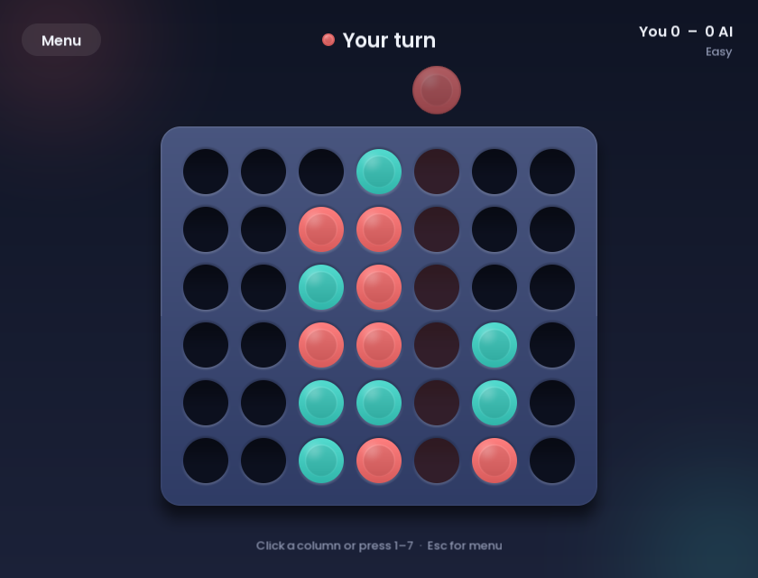
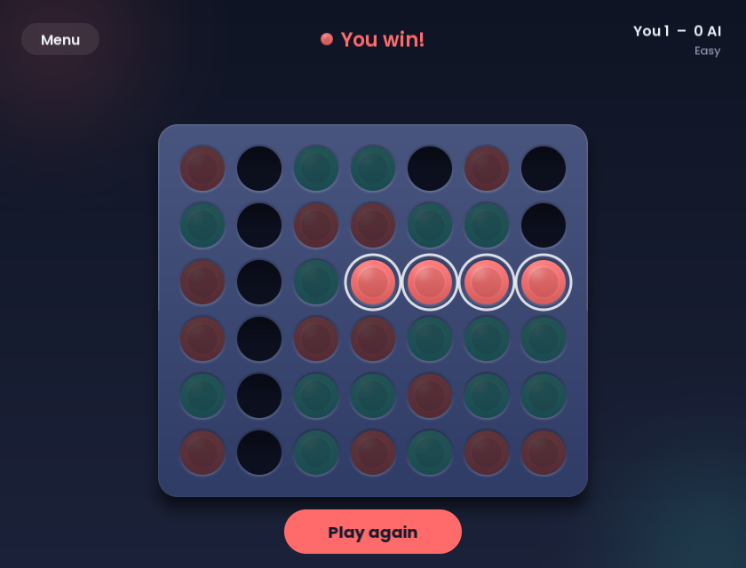

# Four in a Row

A four-in-a-row game in C++17 and SDL2, played against an AI that uses
minimax search with alpha-beta pruning.

<p align="center">
  
  
</p>

## Features

- Three difficulty levels (the AI looks 2, 4 or 8 moves ahead) and a choice of who moves first
- Board and pieces drawn in code with anti-aliased edges, sharp on high-DPI screens
- Preview of where your piece will land, falling pieces, highlighted winning line
- The AI searches on a background thread, so the window never freezes
- Mouse or keyboard play
- Rules and AI are a separate library with unit tests and a benchmark

## How the AI works

The rules live in [`core/board.h`](core/board.h): a 6×7 grid where pieces are
dropped and taken back with `play()` and `undo()`. After each move,
`connectsFour()` checks only the four lines through that piece, which is all
the search needs.

The AI ([`core/ai.cpp`](core/ai.cpp)) looks a fixed number of moves ahead:

- **Evaluation.** Every window of four cells that holds pieces of only one
  player is worth 1, 15 or 40 points for 1, 2 or 3 pieces. The AI's windows
  count for it, the opponent's against it.
- **Minimax.** The AI assumes both players pick their best move at every
  level of the tree.
- **Alpha-beta pruning.** A move stops being explored as soon as it is clear
  the opponent would never allow it. The result is identical to minimax; a
  test checks this over hundreds of random positions.
- **Move ordering.** Central columns are tried first. They are usually
  stronger, and finding a strong move early lets alpha-beta cut more.
- **Quicker wins score higher.** A win found closer to the current position
  scores more, so the AI wins as fast as it can and delays a loss.

The search plays and undoes moves on a single board, so it allocates nothing.

### Benchmark

Positions visited to choose a move, summed over four opening positions
(`connect4_bench`, Release build):

| Depth | Minimax | Alpha-beta | Alpha-beta, centre first |
|---:|---:|---:|---:|
| 4 | 10,235 | 4,553 | 2,006 |
| 5 | 69,168 | 28,464 | 17,355 |
| 6 | 468,064 | 109,869 | 41,539 |
| 7 | 3,135,502 | 712,281 | 391,799 |
| 8 | 20,908,249 | 2,465,521 | 902,471 |

At depth 8, move ordering plus alpha-beta visits 23 times fewer positions
than plain minimax (about 0.3 s instead of 10 s for the four positions).

## Building

You need CMake 3.21 or newer and a C++17 compiler. SDL2, SDL2_ttf and doctest
are downloaded and built automatically.

```sh
cmake -S . -B build
cmake --build build --config Release
```

On Windows you can also open the folder in Visual Studio 2022. On Linux, SDL
needs the usual X11 or Wayland development packages (for example
`libx11-dev libxext-dev` on Debian/Ubuntu).

Run the tests and the benchmark:

```sh
ctest --test-dir build -C Release
./build/Release/connect4_bench     # build/connect4_bench on Linux
```

## Controls

| | |
|---|---|
| Click a column, or press <kbd>1</kbd>–<kbd>7</kbd> | Drop a piece |
| <kbd>←</kbd> <kbd>→</kbd> and <kbd>Enter</kbd> | Aim and drop |
| <kbd>Esc</kbd> | Back to the menu |
| <kbd>F12</kbd> | Save a screenshot next to the executable |

## Project layout

```
core/    rules (Board) and AI, no SDL dependency
app/     the SDL front end: menu, game screen, drawing code
tests/   unit tests (doctest)
bench/   search benchmark
assets/  fonts
```
